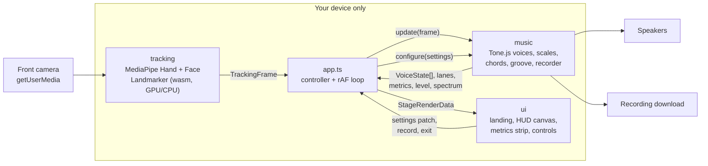

# Orchestrator

**Play a whole orchestra with your hands and your mouth.**

<!-- LIVE-DEMO: replace this line with the GitHub Pages link once it is published -->
**Live demo: coming soon**

Open the page, press **Start** and raise a hand. Your index fingertip picks the note: higher hand,
higher note. Open your mouth to play it. The wider you open it, the louder it gets, the way a
breath controller works. Bring in your second hand to shape the volume like a theremin, play a bass
line or strum chords under the melody. More than 30 sampled and synthesized instruments, a live
heads-up display that tracks every finger, and a musician's metrics strip that shows what you are
playing as you play it.

Everything runs in your browser. Hand and face tracking (MediaPipe) and the audio engine (Tone.js)
run on your device. No video, image or sound ever leaves it, and there is no account, no backend
and no analytics.

---

## Contents

- [Features](#features)
- [How to play](#how-to-play)
- [Tech stack](#tech-stack)
- [Architecture](#architecture)
- [Local development](#local-development)
- [Building](#building)
- [Deploy to GitHub Pages](#deploy-to-github-pages)
- [Deployment with Docker](#deployment-with-docker)
- [Configuration](#configuration)
- [Browser support](#browser-support)
- [Troubleshooting](#troubleshooting)
- [Credits and licenses](#credits-and-licenses)

---

## Features

- **Gesture instrument.** Fingertip height picks the pitch, mouth opening is the gate and the
  loudness. The lead voice follows your right hand, or your only hand.
- **30+ instruments** in 11 families: pianos and keys, acoustic and electric guitars, basses,
  strings, an opera choir, brass, woodwinds, mallets, organs, world instruments and synthesizers.
  Samples load on demand when you pick an instrument.
- **Second-hand roles.** The left hand can control the volume (theremin style, the default), play
  a bass line, play chords (raise 1 to 5 fingers for chords I to V of the key), or be ignored.
- **One-tap presets.** Grand Stage, Opera Night, Theremin, Campfire and Night Groove set up the
  instrument, second-hand role, key, scale, beat and reverb in one tap.
- **Hand gestures with configurable actions.** Hold a pose for half a second to trigger an
  action: by default a fist mutes, a peace sign switches to the next instrument, a thumbs-up starts
  or stops the beat and the rock sign shifts up an octave. Every gesture can be bound to another
  action (octave down, previous instrument, next preset, next scale, start/stop recording) or
  switched off.
- **Scales and keys.** Major, minor, major and minor pentatonic, blues, dorian, mixolydian,
  harmonic minor, Japanese, chromatic, and a continuous mode for free glides. Any of the 12 keys,
  an octave shift and an adjustable note span. Note lanes on screen show where every note is.
- **Live metrics strip.** Key and scale, the current chord with its roman numeral, the sounding
  notes, the active instruments, the output level in dB, BPM with bar and beat, notes played and
  session time, plus a mini piano keyboard that lights the sounding notes, all in sync with the audio.
- **Futuristic HUD.** Animated brackets lock onto each hand, a reticle on the fingertip, a lips
  outline, glowing note lanes and particles on every note onset.
- **Best-frame flag.** A live framing indicator tells you when the picture is ideal for tracking,
  and what to fix when it is not: too dark, too bright, too far, too close, a hand cut off by the
  edge, or an unstable picture.
- **Mouth sensitivity.** Tune how wide the mouth has to open before a note plays.
- **Shareable setup links.** Copy a link that reproduces your instrument, key, scale, tempo and
  the rest of the musical setup (for example `#lead=theremin&scale=minor&key=9`).
- **Fullscreen and help.** A fullscreen stage for performing and a help overlay that explains
  every gesture.
- **Groove.** An optional backing beat with adjustable tempo (60 to 160 BPM).
- **Recording.** Record a take and download it as an audio file (WebM or M4A, whichever your
  browser records).
- **Three trigger modes.** Mouth (default), thumb-to-index pinch, or always on while a hand is in
  view.
- **Low-power mode.** Fewer tracking frames, no particles and a lower canvas resolution for
  older phones and laptops. The app also degrades by itself when frames get slow, and pauses
  everything while the tab is hidden.
- **Private by design.** Camera frames are processed in memory on your device and never stored or
  sent anywhere. Every model, runtime file, sample and font is served by the app itself, so no
  third-party request is made at runtime. Settings are kept in your browser's local storage.

## How to play

Stand or sit about an arm's length from the camera with your face and shoulders in view.

| Gesture | What it does |
| --- | --- |
| Raise one hand | Activates the lead voice. With two hands up, the right hand is the lead. |
| Move the index fingertip up and down | Picks the note. Top of the screen is the highest note. |
| Open your mouth | Plays the note. Mouth openness sets the loudness, like breathing into a horn. |
| Close your mouth | Releases the note. Plucked and struck instruments ring out naturally. |
| Pinch thumb and index | Plays the note when the trigger is set to **Pinch**. |
| Left hand up or down (role: **Volume**) | Theremin-style loudness: top is loud, bottom is silent. |
| Left hand up or down (role: **Bass**) | Plays the bass voice. Its height picks the bass note. |
| Raise 1 to 5 fingers (role: **Chords**) | Plays chord I, II, III, IV or V of the key under the melody. A fist stops the chord. |

Gesture actions fire when a pose is held for about half a second (the HUD shows the hold
progress). Defaults, all configurable in the controls:

| Pose | Default action |
| --- | --- |
| ✊ Fist | Mute that hand's voice while held |
| ✌️ Peace | Next instrument |
| 👍 Thumbs up | Beat on / off |
| 🤘 Rock | Octave up |

In **Chords** mode the left hand's finger counts pick chords, so its poses never trigger actions.

Tips: light your face from the front, keep a plain background behind your hands if you can, and
start with a pentatonic scale: every note sounds good together.

## Tech stack

| Area | Technology |
| --- | --- |
| Language and build | TypeScript (strict), Vite, no UI framework |
| Hand and face tracking | [MediaPipe Tasks Vision](https://ai.google.dev/edge/mediapipe/solutions/vision/hand_landmarker): HandLandmarker and FaceLandmarker, WebAssembly with a GPU (WebGL) delegate and a CPU fallback |
| Audio | [Tone.js](https://tonejs.github.io/) on the Web Audio API: samplers, synths, effects, transport, recorder |
| Rendering | Canvas 2D overlay on a mirrored `<video>` with `object-fit: cover` |
| Serving | nginx (unprivileged, read-only filesystem) in a small Alpine image with built-in HTTPS |

## Architecture

The app is three independent modules wired together by a small controller. They only know each
other through the shared contract in [`src/types.ts`](src/types.ts).

| Module | Responsibility | Produces |
| --- | --- | --- |
| [`src/tracking`](src/tracking) | Opens the camera, runs MediaPipe on every video frame, smooths landmarks, assigns stable hand ids, derives fingertip, pinch, finger count and mouth openness | `TrackingFrame` |
| [`src/music`](src/music) | Maps a `TrackingFrame` and the `Settings` to sound with Tone.js: lead and bass voices, chords, scales, groove, recording, metrics | `VoiceState[]`, `Lane[]`, `MusicMetrics` |
| [`src/ui`](src/ui) | Landing page, stage, HUD overlay, metrics strip and controls | `Partial<Settings>` patches, user actions |
| [`src/app.ts`](src/app.ts) | Lifecycle: landing, Start, camera, models, audio, the stage loop, exit and clean-up | |

Supporting files: [`src/geometry.ts`](src/geometry.ts) maps normalized camera coordinates to
screen pixels for the cover-fitted, mirrored video; [`src/settings.ts`](src/settings.ts)
validates and persists settings; [`src/config.ts`](src/config.ts) holds the self-hosted asset
URLs; [`src/dev/mockTracker.ts`](src/dev/mockTracker.ts) generates synthetic frames for
camera-free runs.



All coordinates in the contract are normalized to the camera frame (0 to 1) and already mirrored
for the selfie view, so every module agrees on what "left" and "top" mean.

### Project layout

```
.
├── src/
│   ├── types.ts            shared contract between the modules
│   ├── app.ts              controller and lifecycle
│   ├── main.ts             entry point
│   ├── geometry.ts         camera-to-screen mapping, play zone
│   ├── settings.ts         defaults, validation, persistence
│   ├── config.ts           asset URLs
│   ├── presets.ts          one-tap presets
│   ├── gestures.ts         held poses -> actions
│   ├── tracking/           camera + MediaPipe
│   ├── music/              Tone.js engine and instruments
│   ├── ui/                 views, HUD, controls
│   └── dev/mockTracker.ts  synthetic tracking for ?mock
├── scripts/
│   ├── fetch-assets.mjs    downloads/copies runtime assets into public/
│   └── assets/             models + wasm, instrument samples
├── deploy/                 nginx config, entrypoint, smoke test
├── Dockerfile
└── docker-compose.yml
```

## Local development

Requirements: Node.js 22 and npm.

```bash
npm ci
npm run dev
```

`npm run dev` first fetches the runtime assets into `public/` (the MediaPipe wasm runtime copied
from `node_modules`, the hand and face models, the instrument samples; files that already exist
are skipped), then starts Vite on <http://localhost:5173>. Browsers treat `localhost` as a secure
origin, so the camera works without HTTPS.

Add **`?mock`** to the URL (<http://localhost:5173/?mock>) to run without a camera: a synthetic
tracker sweeps two hands up and down and opens and closes the mouth, so the UI and the music
engine can be developed and tested anywhere, including headless browsers.

| Script | What it does |
| --- | --- |
| `npm run dev` | Fetch assets, start the dev server with hot reload |
| `npm run assets` | Fetch assets only (`npm run assets -- --force` re-downloads everything) |
| `npm run typecheck` | `tsc --noEmit` |
| `npm run build` | Typecheck and build to `dist/` |
| `npm run preview` | Serve `dist/` on <http://localhost:4173> |

To try it on a phone on the same network you need HTTPS (a LAN IP is not a secure origin): run the
Docker image below and open `https://<your-computer-ip>:8443`.

## Building

```bash
npm ci
npm run assets
npm run build
```

The static site is written to `dist/`. It is built with a relative base path, so it can be served
from any directory or sub-path. Hashed bundles live in `dist/assets/`; the MediaPipe runtime,
models and samples are copied as-is to `dist/mediapipe/`, `dist/models/` and `dist/samples/`.

## Deploy to GitHub Pages

GitHub Pages serves over HTTPS, so the camera works there without any certificate setup. The
build uses a relative base path, so it runs under `https://<user>.github.io/<repository>/`.

1. In the repository, open **Settings → Pages** and set **Source** to **GitHub Actions**.
2. Open **Actions → Deploy to GitHub Pages → Run workflow**.

The workflow ([`.github/workflows/pages.yml`](.github/workflows/pages.yml)) runs `npm ci`,
`npm run assets` and `npm run build`, then publishes `dist/`. It only runs when started by hand,
so nothing is deployed before Pages is enabled.

## Deployment with Docker

The image is a two-stage build: `node:22-alpine` installs, fetches the assets and builds;
the runtime is `nginx:alpine-slim` running as an unprivileged user, serving `dist/` with
pre-compressed assets, strict security headers and HTTPS.

```bash
cp .env.example .env    # set PUBLIC_HOST to your server's IP or hostname
docker compose up -d --build
docker compose ps       # wait for "healthy"
```

Open `https://<your-host>:8443` (the value of `PUBLIC_HOST`).

### Why the container serves HTTPS itself

Browsers only allow camera access on a secure origin: HTTPS, or `localhost`. Opening the app over
plain HTTP on a public IP shows no camera prompt at all. So the container always listens for HTTPS
on port 8443, even when nothing else is configured.

### Self-signed or real certificate

- **Self-signed (default).** On first start the entrypoint creates an ECDSA certificate valid for
  every host in `PUBLIC_HOST` plus `localhost`, `127.0.0.1` and `::1`. It is stored in the `certs`
  volume, reused across restarts and rebuilds, and re-created when `PUBLIC_HOST` changes or it is
  30 days from expiry. Browsers show a warning once; accept it to continue. That is fine for a
  demo or a private server, but not for the public.
- **Real certificate.** Put `fullchain.pem` and `privkey.pem` in `deploy/certs/` (or set
  `TLS_CERT_DIR` to another directory). They are used as-is. The key must be readable by uid 101,
  the container's `nginx` user. For Let's Encrypt, copy the files rather than mounting the `live/`
  directory, because its entries are symlinks into `archive/`:

  ```bash
  sudo cp -L /etc/letsencrypt/live/example.com/{fullchain,privkey}.pem deploy/certs/
  sudo chown 101:101 deploy/certs/*.pem && sudo chmod 0640 deploy/certs/privkey.pem
  docker compose restart
  ```

  Repeat after each renewal (for example from a certbot deploy hook).

### Behind a reverse proxy

If the host already runs a web server on ports 80 and 443, let it terminate TLS with a real
certificate and forward to the container's plain HTTP port, which compose publishes on
`127.0.0.1:8088` only. The container trusts `X-Forwarded-For` on that port for logging and
per-client limits. Example for nginx on the host:

```nginx
server {
    listen 443 ssl;
    http2 on;
    server_name orchestrator.example.com;
    ssl_certificate     /etc/letsencrypt/live/orchestrator.example.com/fullchain.pem;
    ssl_certificate_key /etc/letsencrypt/live/orchestrator.example.com/privkey.pem;
    add_header Strict-Transport-Security "max-age=31536000" always;

    location / {
        proxy_pass http://127.0.0.1:8088;
        proxy_http_version 1.1;
        proxy_set_header Host $host;
        proxy_set_header X-Forwarded-For $proxy_add_x_forwarded_for;
        proxy_set_header X-Forwarded-Proto $scheme;
    }
}
```

With Caddy it is one line: `orchestrator.example.com { reverse_proxy 127.0.0.1:8088 }`.

If the proxy is the only entry point, you can drop the public HTTPS port by removing the
`${HTTPS_PORT}` line from `docker-compose.yml`.

### What the container does

| | |
| --- | --- |
| Ports | 8443 HTTPS + HTTP/2, 8080 plain HTTP for a proxy |
| Health | `GET /healthz` returns `200 ok`; used by the Docker healthcheck |
| Caching | `assets/*` (hashed) immutable for 1 year; wasm, models and samples 30 days; `index.html` revalidated on every load; errors never cached |
| Compression | gzip for HTML, JS, CSS, JSON, SVG and wasm; large files are pre-compressed at build time |
| Routing | unknown paths without a file extension fall back to `index.html`; missing files are real 404s |
| Headers | `Permissions-Policy` (camera for this origin only, everything else off), `Content-Security-Policy`, `X-Content-Type-Options`, `X-Frame-Options`, `Referrer-Policy: no-referrer`, `Cross-Origin-Opener-Policy`, no server version |
| Hardening | non-root user, read-only root filesystem with a small tmpfs, all capabilities dropped, `no-new-privileges`, memory and process limits, rotated JSON logs |

The Content-Security-Policy lives in [`deploy/csp.conf`](deploy/csp.conf). Its header comments
explain each source and how to switch between report-only and enforced mode.

To check a running deployment from the outside:

```bash
deploy/smoke-test.sh https://localhost:8443 http://127.0.0.1:8088
```

Common operations:

```bash
docker compose logs -f              # access log + entrypoint messages
docker compose restart              # pick up a replaced certificate
git pull && docker compose up -d --build
docker compose down                 # stop (keeps the certificate volume)
```

## Configuration

Deployment settings are environment variables, read from `.env` by docker compose:

| Variable | Default | Description |
| --- | --- | --- |
| `PUBLIC_HOST` | `localhost` | Comma-separated IPs and/or hostnames for the self-signed certificate |
| `HTTPS_PORT` | `8443` | Public HTTPS port on the host |
| `HTTP_PORT` | `8088` | Plain HTTP port for a reverse proxy, bound to `127.0.0.1` |
| `TLS_CERT_DIR` | `./deploy/certs` | Directory with a real `fullchain.pem` + `privkey.pem`; empty means self-signed |
| `IMAGE_TAG` | `latest` | Tag of the built image, `web-orchestrator:<tag>` |
| `TLS_DAYS` | `397` | Validity of the self-signed certificate (container environment) |

In-app settings are chosen in the controls panel and saved in the browser:

| Setting | Default | Range |
| --- | --- | --- |
| Lead instrument | Grand piano | any instrument |
| Second-hand instrument | Electric bass | any instrument (bass and chords roles) |
| Second hand | Volume | Volume, Bass, Chords, Off |
| Key / scale | C, major pentatonic | 12 keys, 11 scales |
| Octave / span | 0 / 15 notes | -2..+2 / 8..24 notes |
| Trigger | Mouth | Mouth, Pinch, Always |
| Mouth sensitivity | 50% | 0..100% |
| Gesture actions | on: fist mute, peace next instrument, thumbs-up beat, rock octave up | any action per gesture, or off |
| Groove / tempo | off / 96 BPM | 60..160 BPM |
| Reverb / volume | 35% / 80% | 0..100% |
| Skeleton, note lanes | on | on / off |
| Low-power mode | off | on / off |

## Browser support

| Browser | Status |
| --- | --- |
| Chrome and Edge (desktop) | Fully supported, GPU tracking |
| Chrome (Android) | Supported |
| Safari 16.4+ (macOS, iOS, iPadOS) | Supported. Tap **Start** to unlock audio; the app also plays with the silent switch on |
| Firefox (desktop) | Supported |

Requirements: WebAssembly, WebGL2 for GPU tracking (with a CPU fallback), the Web Audio API with
AudioWorklet, and `getUserMedia` on a secure origin. In-app browsers (inside social or chat apps)
often block the camera; open the page in the system browser instead.

## Troubleshooting

**No camera prompt, or "The camera needs a secure (https) connection".** The page is served over
plain HTTP on a non-localhost address. Use `https://` (port 8443 by default), a reverse proxy
with a real certificate, or GitHub Pages.

**"Your connection is not private" / certificate warning.** That is the self-signed certificate.
Choose *Advanced → Proceed* (Chrome) or *Show Details → visit this website* (Safari). Use a real
certificate for public deployments.

**Camera blocked.** The permission was denied once and the browser remembers it. Allow the camera
from the padlock / site settings in the address bar and reload. On iOS: *Settings → Safari →
Camera → Ask or Allow*. On macOS also check *System Settings → Privacy & Security → Camera* for
your browser.

**"Camera in use".** Another app or tab holds the camera (video calls are the usual suspect).
Close it and press Start again.

**Hands or mouth are not detected well.** Light your face from the front, avoid a bright window
behind you, keep your hands about an arm's length from the camera and fully in the picture, and
face the camera. Plain backgrounds help.

**No sound.** Turn the volume up and press Start again (browsers only start audio after a tap or
click). Check that the trigger mode matches what you do: with **Mouth**, the note only plays while
your mouth is open.

**Laggy or the device gets hot.** Turn on **Low-power mode** in the controls. Close other heavy
tabs. When the status shows the CPU delegate (no usable WebGL2), tracking is slower than on
the GPU.

**The container keeps restarting.** Run `docker compose logs`. The entrypoint explains certificate
problems, for example a `privkey.pem` that uid 101 cannot read.

**The reverse proxy returns 502.** Check that the container is healthy (`docker compose ps`) and
that the proxy targets `127.0.0.1:${HTTP_PORT}` (8088 by default).

## Credits and licenses

Created by **Mohamad Liyaghi**.

Third-party components bundled or served by the app:

| Component | Used for | License |
| --- | --- | --- |
| [MediaPipe Tasks Vision](https://github.com/google-ai-edge/mediapipe) and its hand and face landmarker models | Hand and face tracking | Apache-2.0 |
| [Tone.js](https://github.com/Tonejs/Tone.js) | Audio engine | MIT |
| FluidR3_GM instrument samples, via [gleitz/midi-js-soundfonts](https://github.com/gleitz/midi-js-soundfonts) | Sampled instruments | <!-- SAMPLES-LICENSE: to be confirmed by the music module --> _to be confirmed_ |
| [Space Grotesk](https://github.com/floriankarsten/space-grotesk) and [JetBrains Mono](https://github.com/JetBrains/JetBrainsMono) | Typefaces | SIL Open Font License 1.1 |
| [nginx](https://nginx.org/) | Web server in the Docker image | BSD-2-Clause |
